# 📊 UIII Act3: Importación y Descripción de Datos
## Christian Garcia Jimenez Nc = 0068
> **🎓 Asignatura:** Soluciona problemas de Machine Learning  
> **📚 Nivel:** Tercer semestre de preparatoria  
> **🤖 Especialidad:** Inteligencia Artificial  
> **📈 Dificultad:** Cero a principiante  
> **🐍 Lenguaje:** Python  
> **🛠️ Herramientas:** Visual Studio Code, Pandas, Matplotlib y CSV 

## Empleados de industria 

## Tabla original empleado

## Convertir el DataFrame en archivo CSV

## Datos de csv --> Base de datos

##  Leer los datos desde el archivo CSV
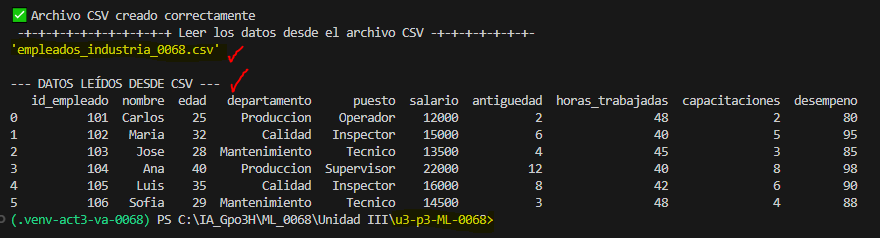

##  Análisis Exploratorio de Datos (EDA)
### Primeros y últimos registros
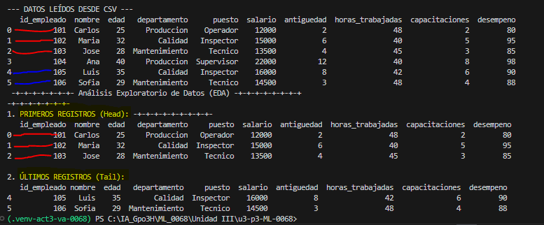

## Dimensiones y estructura
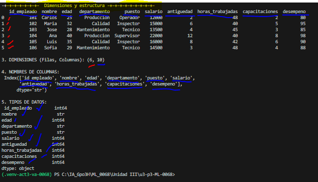

## Estadisticas y limpieza
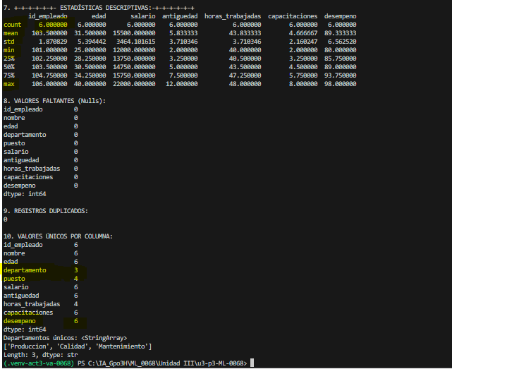

## Ordenamiento, filtrado y agrupación 8 y 9
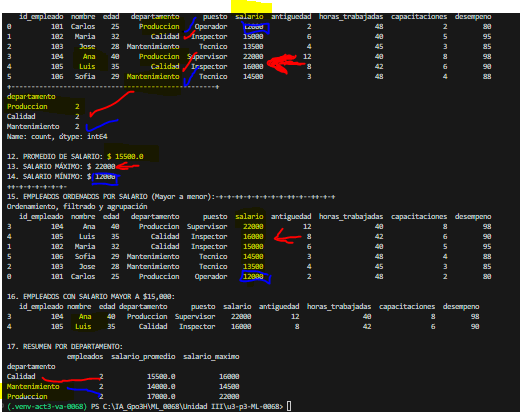

## 18. Gráfica de barras: Empleados por departamento
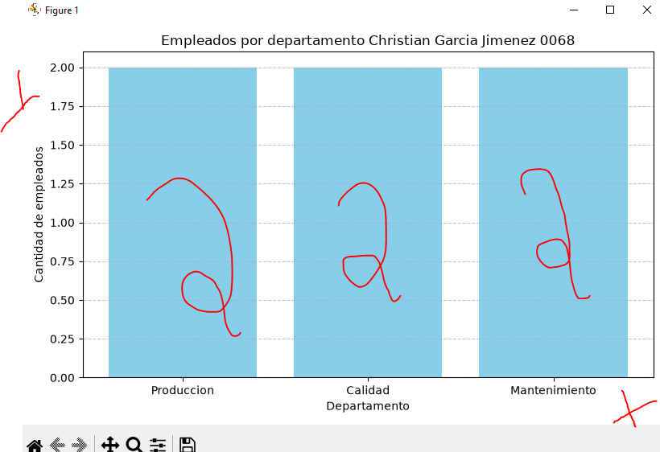

## 19. Gráfica de barras: Salarios por empleado
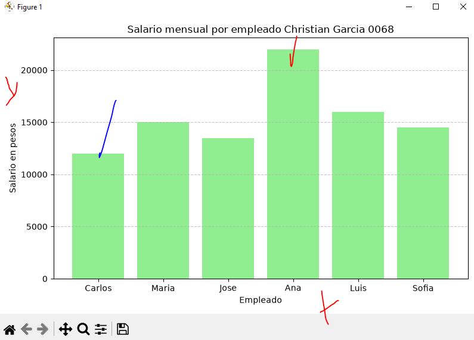

## 20. Histograma: Distribución de edades
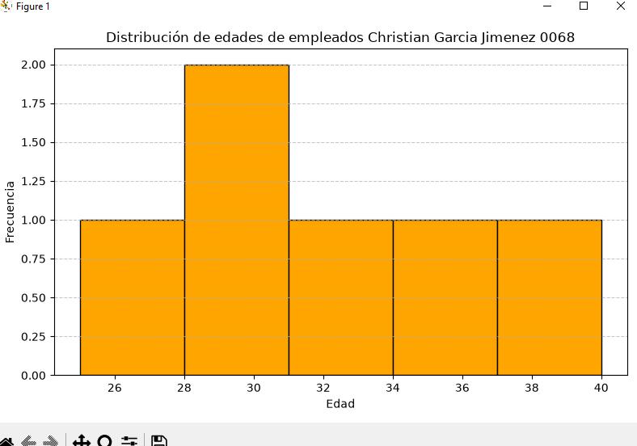

## 21. Gráfica de dispersión: Edad vs Salario
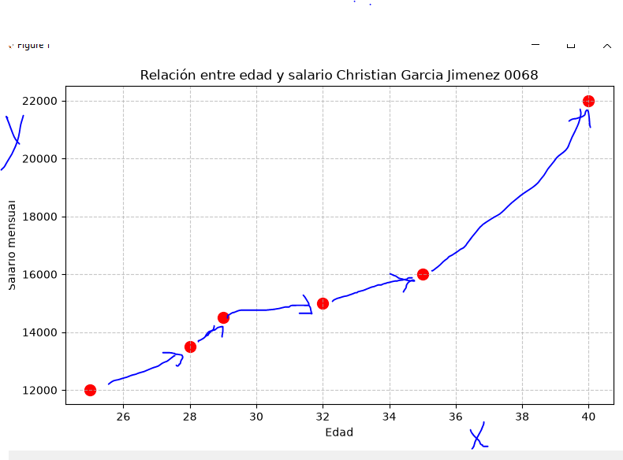

## 22. Diagrama de caja: Distribución de salarios
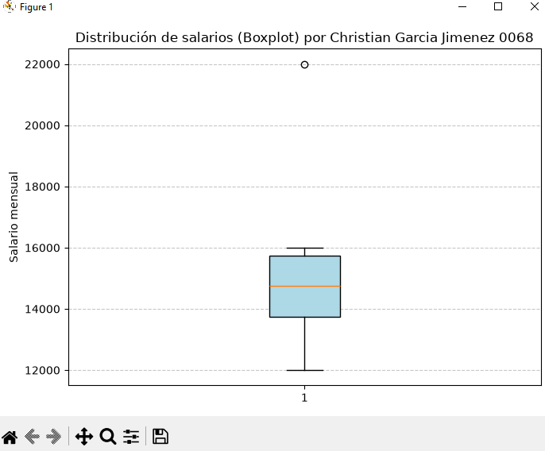

## 23. Matriz de correlación
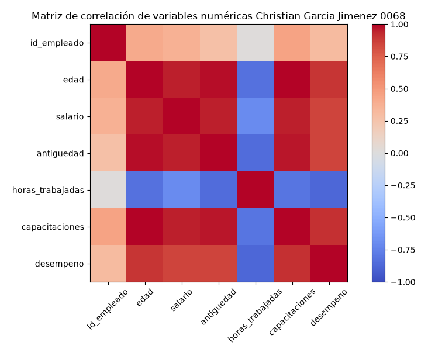

